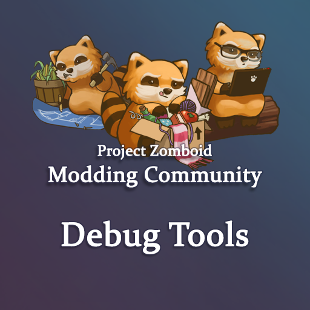

### Features included here should be tools meant for debugging coding problems only.
### Quality of life changes to vanilla tools or debugging features are also included.

- (New) Integrates much of Aiteron's AUD debug tools, with some removed or streamlined.
    - (New) Teleport panel for saving map points and jumping between them, with categories, quick add and an MP players tab.
    - (New) Lua explorer for reloading single files, favorites or whole mods, including the server's copies in MP.
    - (Tweak) AUD's Spawn Vehicle UI was dropped in favor of improving vanilla's.

- (New) Object inspector for an object's modData and Java fields from the right-click menu, with a client/server toggle in MP.

- (Tweak) Spawn Vehicle UI can target the car you're in, toggle hotwire, outlines the targeted car's size on the floor and reloads scripts on the server too.

- (New) API for adding more buttons to the Debug menu. See [debugToolbar.lua](42/media/lua/client/CommunityDebugTools/debugToolbar.lua).

- (Tweak) Debug windows remember their layout.

- (Tweak) Cheats / Admin Powers apply as soon as they're ticked instead of needing Save.

- (New, B41) Micro-Map, a 2x2 map by Dane (concept by Reifel) for faster reloads.

- (Fix, B41) Stops the Moodles & Body Fitness slider setting Fitness to level 10.

- (Fix, B42) Stats & Body edits that vanilla doesn't sync in MP are sent to the server.

- (Tweak, B42) Global ModData debugger can show the server's tables in MP.

- (Tweak, B42) Attachment Editor gets prop points, auto-attaching items when one of their attachments is selected, transform copy/paste/typing, arrow-key nudging, 3/4 views, a saved free camera with a live preview and a selectable grid plane.

- (Tweak) Player Stats opens Add XP on the selected skill.

- (Fix, B42) Player Stats follows the player after death and respawn.

- (Fix, B42) Craft Recipes debug window no longer errors on open.

- (Fix) Item list viewer shows icons for mod items.

- (Tweak) Swaps the sidebar debug button for a bigger icon.

- (Tweak) Lua console can be opened on the main menu.

- (New) Custom debug scenarios list, with an example scenario. See [DebugScenarios](42/media/lua/client/CommunityDebugTools/DebugScenarios/).

- (Tweak, B42) `print` tags its output with the calling mod's ID and writes through `DebugLog.log`, which is faster than vanilla's print.

- (New) Utility to mark every stash location on the map. See [stashMapMarkers.lua](42/media/lua/client/CommunityDebugTools/stashMapMarkers.lua).

- (Tweak) Debug context menu is reorganised, with zombie and body tools that run server-side in MP.

- (New, B42) MP debug commands are checked against the sender's capabilities on the server. See [Commands](42/media/lua/shared/CommunityDebugTools/Commands/).

- (Fix, B42) Fire, smoke and explosion brushes work in single player instead of erroring.

- (Tweak, B42) Tile chooser searches by sheet, sprite or tile name, outlines matching tiles and shows names on hover.

- (New, B42) Brush Tool Manager has a destroy brush toggle (with an include floors option) that removes the top object on clicked squares, with R cycling through the objects on a square, server-side in MP.
