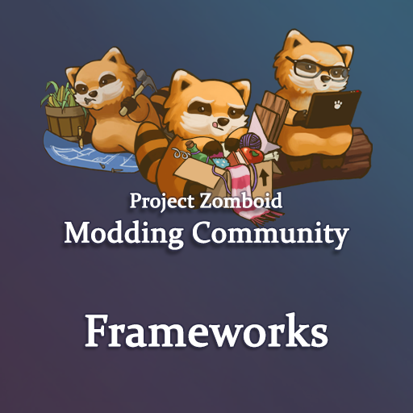

### Frameworks should include new utility functions and quality of life changes to vanilla features as to assist other modders.

- (Tweak, B41) Vehicle seat UI scales for 4k or larger resolutions and adapts to vehicles with unusual seating.

- (New, B41) Alternatives to vanilla's local `addExistingItemType`, which also has performance concerns. See [recipeCodePatches.lua](media/lua/server/recipeCodePatches.lua).

- (New) `debounce` utility for running something once a repeated action has stopped. See [debounce.lua](42/media/lua/shared/utils/debounce.lua).

- (New, B42) `ModOptionsAPI`, a simple wrapper for B42 mod options with optional sandbox sync. See [ModOptionsAPI.lua](42/media/lua/client/ModOptionsAPI.lua).

- (New, B42) `RadialMenuAPI` to add, replace or remove slices in the emote, light source and vehicle radial menus, hard overwriting their vanilla fill functions to do so. See [RadialMenuAPI](42/media/lua/client/RadialMenuAPI/).

- (New, B42) `AnimAPI` sets animation variables from equipped items and worn clothing, synced in MP. See [AnimAPI](42/media/lua/client/AnimAPI/).
