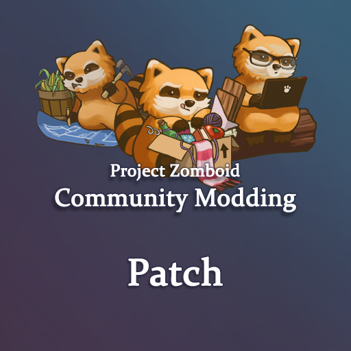

### Patch should include quality of life changes / bug fixes to the end-user experience.

- (Fix) Stops the fitness action giving XP forever when started while sprinting.

- (Fix) Stops MP-removed traits being re-added when toggling mutually exclusive traits.

- (Fix) Fixes the game mode not getting reset when continuing a challenge save from a mod.

- (Tweak) Item scripts that fail `getDisplayName` log an error once and show "ERROR" instead of breaking.

- (Fix, B41) Fixes vehicle hoods staying up after closing the mechanics window.
